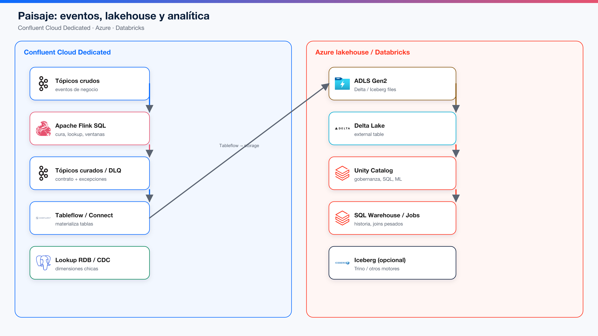
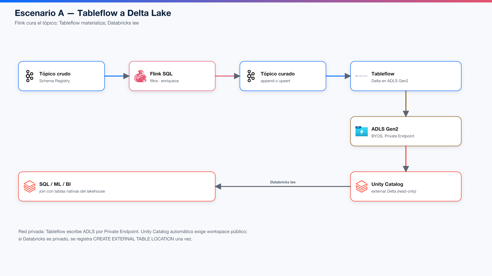
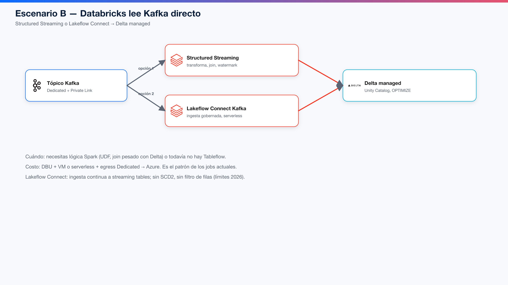
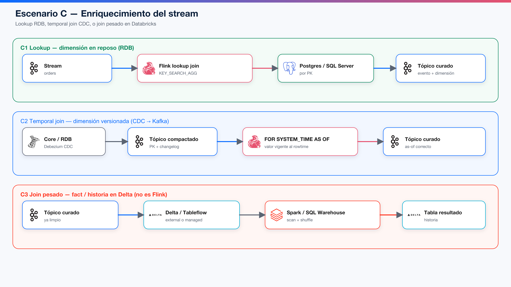
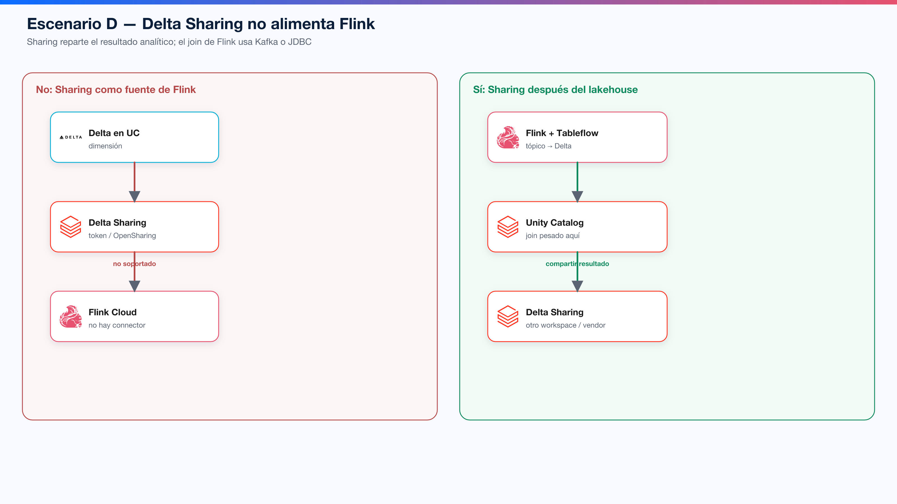
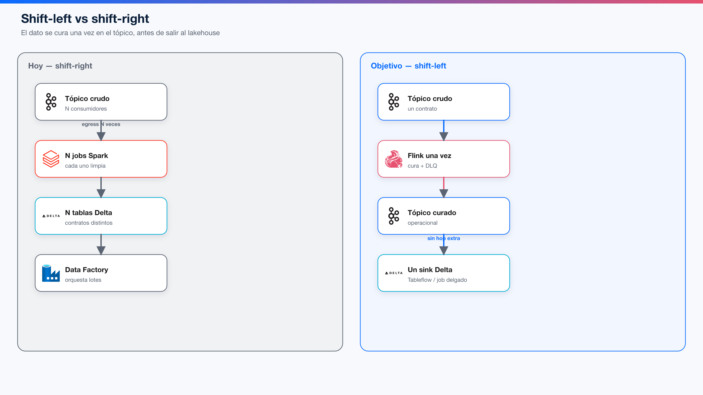

# Eventos Kafka hacia Databricks y el lakehouse

Cómo llevar un tópico de Confluent Cloud Dedicated hasta una tabla analítica (Delta Lake o Iceberg) y, si aplica, enriquecerlo antes. El lakehouse **no es Databricks**: es storage (ADLS Gen2) + formato de tabla (Delta / Iceberg) + catálogo (Unity Catalog). Databricks es el motor que el Banco usa encima.

Consultado el 14 de octubre de 2026.



---

## 1. Piezas

| Pieza | Dónde vive | Rol |
|---|---|---|
| Tópico Kafka | Confluent Cloud Dedicated | Sistema de registro operacional del evento |
| Schema Registry | Confluent Cloud | Contrato Avro / JSON Schema / Protobuf |
| Apache Flink SQL | Confluent Cloud (CFU) | Cura, lookup, ventanas, ruteo **antes** de salir |
| Tableflow | Confluent Cloud | Materializa el tópico como Delta o Iceberg en *tu* storage |
| Kafka Connect | Confluent Cloud o self-hosted | Sink JDBC, S3, etc. cuando Tableflow no aplica |
| ADLS Gen2 | Azure | Archivos del lakehouse (BYOS) |
| Delta Lake | ADLS | Tabla ACID; Tableflow escribe external read-only |
| Iceberg | ADLS / catalog REST | Alternativa; Trino, Snowflake, Spark |
| Unity Catalog | Azure Databricks | Gobernanza, SQL, ML; registra la Delta de Tableflow |
| Structured Streaming / Lakeflow | Azure Databricks | Databricks **lee Kafka** y escribe Delta managed |
| Delta Sharing / OpenSharing | Databricks | Comparte tablas ya materializadas a terceros |

Flink **no escribe Delta**. Escribe Kafka. El último metro es Tableflow, Connect o Spark.

---

## 2. Cómo elegir el camino

```
¿Origen y destino son Kafka Dedicated?
  sí → Flink SQL (caso BADI). El lakehouse no entra.
  no ↓
¿El destino es una tabla analítica (Delta / Iceberg)?
  sí ↓
    ¿El evento hay que curarlo / enriquecerlo / decidirlo en caliente?
      sí → Flink sobre el tópico + Tableflow (o un sink único)     [A]
      no → Tableflow directo sobre el tópico crudo                 [A']
           o Lakeflow Connect / Structured Streaming               [B]
  no ↓
¿El destino es un RDB / core?
  sí → Connect JDBC sink (Flink Cloud no es sink JDBC masivo)     [E]
```

El 5% de los 20.000 procesos con origen Kafka Dedicated se reparte entre A, A', B y el caso BADI. El 95% nunca entra aquí.

---

## 3. Escenarios

### A. Shift-left + Tableflow → Delta (recomendado)



```
tópico crudo → Flink SQL → tópico curado (+ DLQ)
                              ↓
                         Tableflow (Delta, BYOS ADLS)
                              ↓
                    Unity Catalog (external, read-only)
                              ↓
                    SQL Warehouse / Jobs / ML
```

**Cuándo.** El origen es Kafka Dedicated y el lakehouse debe ver un contrato limpio. Varios jobs Spark limpian hoy el mismo crudo.

**Qué hace cada uno**

- Flink: filtro, dedup, PII, lookup, ventanas cortas.
- Tableflow: schematización, evolución de schema, CDC/upsert, commits Delta Kernel, publicación al catálogo ([overview](https://docs.confluent.io/cloud/current/topics/tableflow/overview.html)).
- Databricks: lee la Delta externa. No es writer de esa tabla.

**Azure / red privada (Banco)**

- Tableflow en Dedicated/Enterprise puede escribir ADLS por **Private Endpoint** (blob + dfs) ([Azure private networking](https://docs.confluent.io/cloud/current/topics/tableflow/operate/tableflow-private-networking-azure.html)).
- Storage Confluent-managed **no** está en clusters privados: hay que usar BYOS.
- La integración **automática** con Unity Catalog **exige workspace Databricks público**. Si UC está en red privada (el caso típico del Banco), Tableflow **sigue escribiendo ADLS**; se registra una vez:

```sql
CREATE EXTERNAL TABLE IF NOT EXISTS catalog.schema.topic_name
USING DELTA
LOCATION 'abfss://container@account.dfs.core.windows.net/tableflow/...';
```

Tableflow actualiza los archivos; Unity Catalog no necesita re-sync ([Unity Catalog](https://docs.confluent.io/cloud/current/topics/tableflow/how-to-guides/catalog-integration/integrate-with-unity-catalog.html)).

**Costo.** CFU de Flink + Tableflow (topic-hour + GB procesados + storage si no es BYOS) + egress Kafka **una vez** hacia ADLS. Se apagan N clusters Spark de limpieza. Databricks sigue cobrando SQL/Jobs sobre la tabla.

### A'. Tableflow directo (sin Flink)

El tópico ya nace limpio (Schema Registry + productor disciplinado). Tableflow sobre el crudo. Más barato; no hay contrato curado ni DLQ en el stream.

### B. Databricks lee Kafka directo



Dos productos Databricks:

| Producto | Qué es | Límites relevantes (2026) |
|---|---|---|
| **Structured Streaming** (`spark.readStream.format("kafka")`) | Control total: transform, join con Delta, watermark, foreachBatch | En serverless, trigger continuo no; usar `availableNow` o Lakeflow continuous. Egress Dedicated → Azure. |
| **Lakeflow Connect Kafka** | Ingesta gobernada a *streaming tables*, serverless, Unity Catalog | Sin SCD2, sin filtro de filas; evolución de schema solo columnas nuevas. Fan-out a varias tablas está en preview. |

**Cuándo.** Necesitas UDF Spark, un join contra fact tables Delta **durante** la ingesta, o Tableflow todavía no está habilitado en el cluster.

**Cuándo no.** Es el patrón caro de hoy: cada job paga DBU + (classic) VM + egress. Si solo materializas, Tableflow gana.

Documentación: [Connect to Kafka](https://docs.databricks.com/aws/en/connect/streaming/kafka/), [Lakeflow Connect Kafka](https://docs.databricks.com/aws/en/ingestion/lakeflow-connect/kafka).

### C. Enriquecimiento (joins con dato en reposo)



Tres subcasos. No se mezclan.

#### C1. Lookup — la dimensión está en un RDB

Flink pregunta **por PK** a Postgres, MySQL, SQL Server u Oracle (`confluent-jdbc`, `KEY_SEARCH_AGG`). Read-only. Hay caché. El RDB debe aguantar el QPS.

```sql
SELECT o.*, c.*
FROM orders AS o,
LATERAL TABLE (
  KEY_SEARCH_AGG(customers_ext, DESCRIPTOR(o.customer_id), id)
) AS c;
```

Catálogos chicos y estables: producto, sucursal, moneda, feriados.

#### C2. Temporal join — la dimensión cambia (CDC)

Debezium → tópico compactado con PK → `FOR SYSTEM_TIME AS OF o.\`$rowtime\``. Obtienes el cliente *de ese instante*, no el de ahora. En Confluent Cloud el temporal join sobre tabla regular es **streaming**; en snapshot se usa lookup.

Maestros que mutan: cliente, límite, lista negra, precio.

#### C3. Join pesado — fact / historia en Delta

Flink **no** hace scan de 5 años de Delta. El tópico curado se materializa (A) y **Databricks** hace el `JOIN` contra la fact table nativa. Ahí sí caben shuffle, Photon, SQL Warehouse.

Regla: Flink joinea por clave en el momento del evento. Databricks joinea por scan sobre historia.

### D. Delta Sharing



**No** hay connector Delta Sharing en Flink Cloud. Sharing (OpenSharing) entrega un share + token a Spark, pandas, Power BI, Trino. No a `KEY_SEARCH_AGG`.

Usos válidos:

- Otro workspace Databricks, un vendor o un área que no debe entrar al Dedicated.
- Publicar la Delta que Tableflow o Spark ya materializó.

Si insistieras en “Sharing para enriquecer Flink”, habría que **copiar el share a un tópico** (job Spark) y recién ahí joinear: un hop extra, latencia y costo. Pierde el argumento de shift-left.

### E. Hacia un RDB, no hacia el lakehouse

Flink Cloud JDBC es **lookup**, no sink masivo. Para escribir PostgreSQL / SQL Server:

```
tópico curado → Kafka Connect JDBC (o Debezium sink) → RDB
```

Eso es ODS / operacional, no lakehouse. No lo uses para “llenar Delta”.

### F. Iceberg en lugar de (o además de) Delta

Tableflow también materializa **Iceberg** y publica a Iceberg REST Catalog, Glue, Snowflake Open Catalog, Unity (Iceberg). Útil si hay consumidores que no son Databricks (Trino, engines Iceberg).

En clusters **privados**, el Iceberg REST catalog *built-in* de Tableflow **no está**; hay que usar un catálogo externo. Delta + Unity (manual si UC es privado) es el camino más corto en el Banco Azure.

Databricks puede leer Iceberg vía Unity Catalog Iceberg REST; las Delta managed pueden exponerse a clientes Iceberg si se habilita Iceberg reads.

### G. Auto Loader (archivos, no Kafka)

`cloudFiles` / Auto Loader lee **ADLS/S3**, no tópicos. Entra si alguien baja Kafka a archivos (Connect S3 sink) y Databricks los ingiere. Es un hop más. No es integración Kafka-nativa; evítalo salvo que el archivo ya sea el contrato (regulatorio, partner).

### H. Kafka como sink desde Databricks

Spark también **escribe** Kafka (`writeStream.format("kafka")`). Es el camino inverso: un job lakehouse publica un resultado operacional. No es “eventos hacia el lakehouse”; es “el lakehouse habla de vuelta”. Mantenerlo para scores, listas, features que un trabajador en AKS debe ver en un tópico.

---

## 4. CDC hacia el lakehouse

Tableflow entiende changelog Debezium en modo upsert si:

- usas `after.state.only=true` en el connector, o
- Flink decodifica el envelope (`value.format = *-debezium-registry`) y escribe un tópico “plano” sobre el que habilitas Tableflow ([materialize CDC](https://docs.confluent.io/cloud/current/topics/tableflow/concepts/materialize-cdc.md)).

Lakeflow Connect Kafka **no** hace SCD2. SCD2 sigue siendo un job/pipeline Databricks sobre la tabla ya materializada, o un Flink más expresivo que emita el changelog SCD2 a otro tópico.

---

## 5. Comparación rápida

| Escenario | Cura el evento | Materializa | Join con reposo | Red típica Banco | Costo dominante |
|---|---|---|---|---|---|
| A Flink + Tableflow | Flink | Tableflow → Delta external | C1/C2 en Flink; C3 en Databricks | PE Dedicated + PE ADLS | CFU + Tableflow + 1 egress |
| A' Tableflow solo | Productor | Tableflow | C3 en Databricks | Igual | Tableflow + 1 egress |
| B Structured Streaming | Spark | Delta managed | En el mismo job Spark | PE Dedicated → Databricks | DBU + VM + egress **por job** |
| B Lakeflow Connect | Mínima | Streaming table | No (límites) | Igual | Serverless DBU + egress |
| D Sharing | N/A | Ya existe | No en Flink | Público o Databricks-to-Databricks | Storage + recipient |
| E Connect JDBC | Flink o nada | RDB | Lookup inverso | VNet / PE al RDB | Connect task-hour + RDB |
| F Iceberg | Igual que A | Tableflow Iceberg | Igual | Catálogo externo si red privada | Como A |
| BADI (Kafka→Kafka) | Flink | No hay lakehouse | C1/C2 | Todo dentro de Dedicated | CFU (caso −60%) |

---

## 6. Shift-left aplicado al lakehouse



Hoy: el crudo sale N veces a N jobs Spark, cada uno con su limpieza, y N Deltas distintas.

Objetivo: **un** statement Flink por tópico caliente, **un** tópico curado, **un** sink Tableflow, N lectores Databricks de la misma Delta.

Databricks no se apaga. Deja de ser el primer motor del evento. Sigue siendo historia, SQL, ML, OPTIMIZE, Unity Catalog y el join C3.

Inventario: por **tópico**, no por job. El candidato no es “job 4821”; es `payments.posted` y todo lo que lo consume.

---

## 7. Límites que importan en el Banco

1. Unity Catalog automático de Tableflow **no** habla con Databricks en red privada. Registro manual `CREATE EXTERNAL TABLE`.
2. Tableflow en Dedicated usa **BYOS ADLS**, no storage de Confluent.
3. Flink Cloud **no** hace lookup a Delta ni a Delta Sharing.
4. Flink Cloud JDBC **no** es sink al RDB.
5. Lakeflow Connect Kafka no reemplaza Flink: no filtra filas, no SCD2, no joins.
6. Serverless Spark no corre streaming continuo (`Trigger.ProcessingTime`); o `availableNow` o Lakeflow continuous.
7. Iceberg REST built-in de Tableflow no está en clusters privados.

---

## Fuentes

- [Tableflow overview](https://docs.confluent.io/cloud/current/topics/tableflow/overview.html)
- [Tableflow + Unity Catalog](https://docs.confluent.io/cloud/current/topics/tableflow/how-to-guides/catalog-integration/integrate-with-unity-catalog.html)
- [Tableflow Azure private networking](https://docs.confluent.io/cloud/current/topics/tableflow/operate/tableflow-private-networking-azure.html)
- [Tableflow private networking limits](https://docs.confluent.io/cloud/current/topics/tableflow/operate/tableflow-private-networking.html)
- [Catalog integrations](https://docs.confluent.io/cloud/current/topics/tableflow/how-to-guides/catalog-integration/overview.html)
- [CDC + Tableflow](https://docs.confluent.io/cloud/current/topics/tableflow/concepts/materialize-cdc.md)
- [Flink joins](https://docs.confluent.io/cloud/current/flink/reference/queries/joins.html)
- [Flink external tables](https://docs.confluent.io/cloud/current/flink/concepts/external-tables.html)
- [Databricks Structured Streaming Kafka](https://docs.databricks.com/aws/en/connect/streaming/kafka/)
- [Lakeflow Connect Kafka](https://docs.databricks.com/aws/en/ingestion/lakeflow-connect/kafka)
- [Iceberg REST desde Azure Databricks](https://learn.microsoft.com/en-us/azure/databricks/external-access/iceberg)
